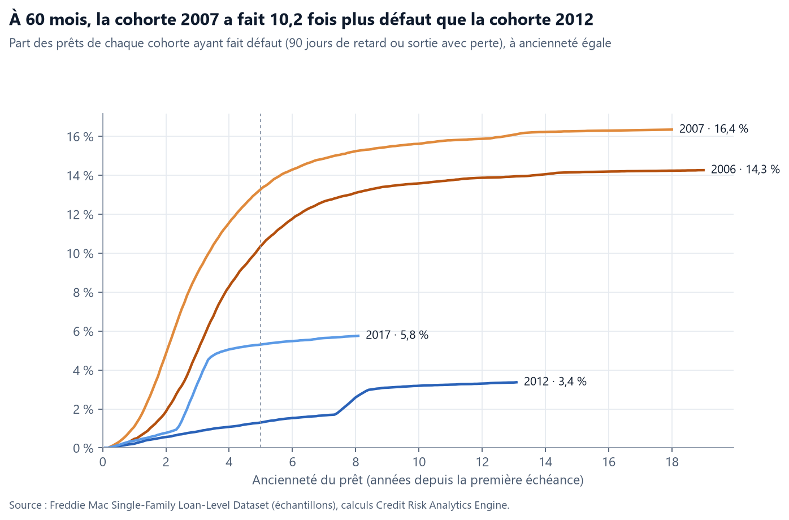
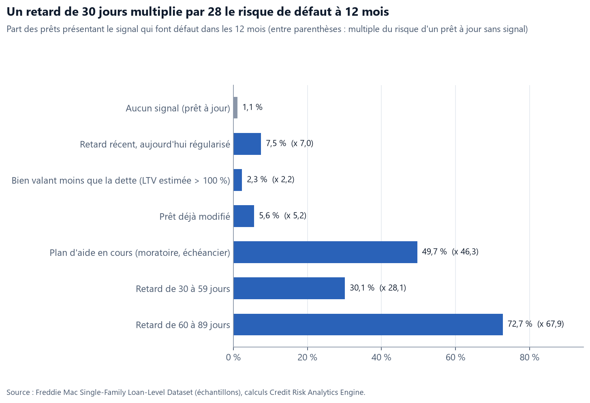
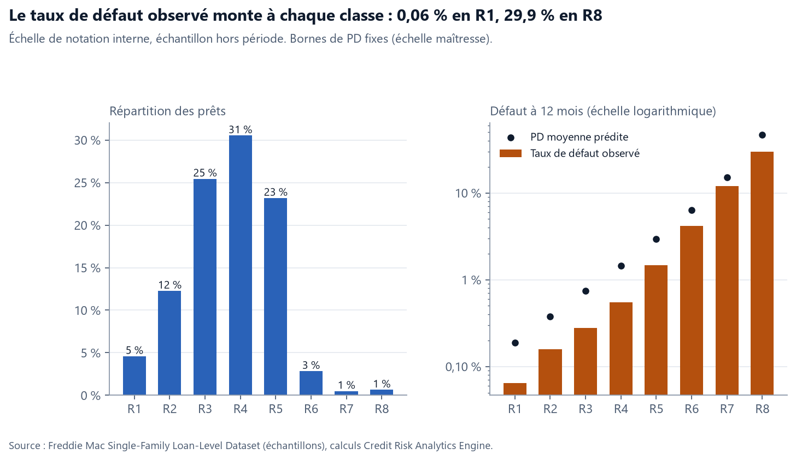
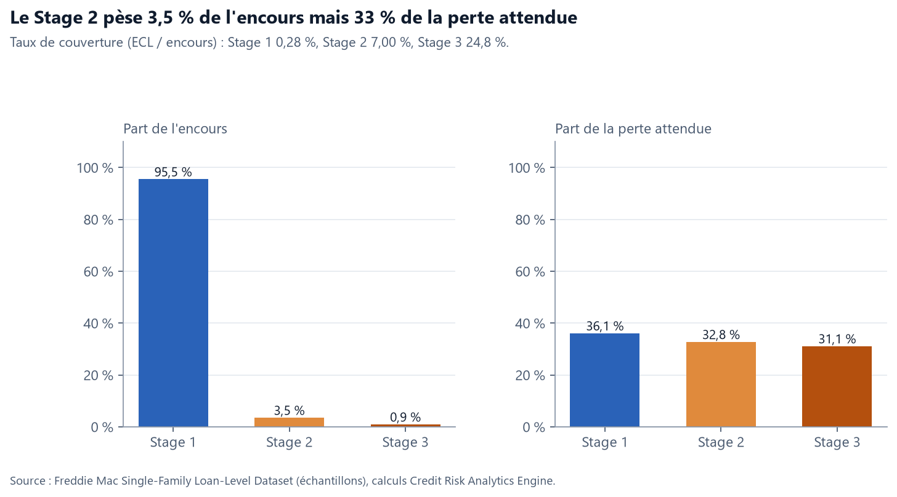
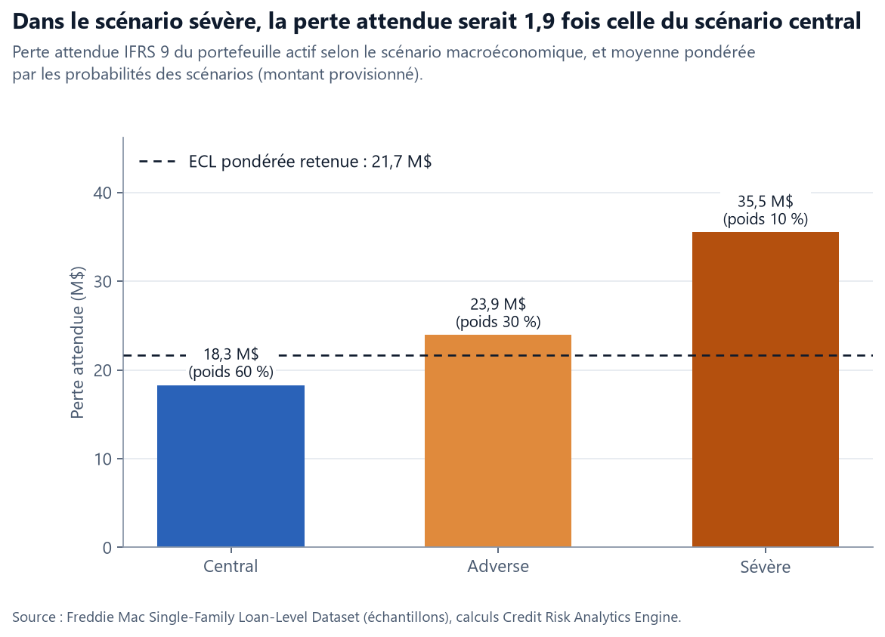

# Credit Risk Analytics Engine

Surveillance du risque de crédit d'un portefeuille de prêts immobiliers à partir des
données granulaires de Freddie Mac (Single-Family Loan-Level Dataset) : taux de défaut,
concentrations, signaux d'alerte, migrations de notation, perte attendue et staging IFRS 9.

> Projet en cours de construction. Phase actuelle : **4 — perte attendue IFRS 9 et capital réglementaire**.

## Problématique

Comment surveiller un portefeuille de prêts, identifier les segments risqués et
détecter les signes de dégradation du crédit avant le défaut ?

## Données

| Source | Contenu | Accès |
|---|---|---|
| Freddie Mac SFLLD (échantillons annuels, 50 000 prêts par cohorte) | caractéristiques à l'octroi, performance mensuelle, pertes réalisées | gratuit, compte Clarity |
| FRED (Réserve fédérale de Saint-Louis) | chômage, taux immobilier 30 ans, Fed funds, indice Case-Shiller | gratuit, sans compte |

Les données Freddie Mac ne sont **pas** incluses dans ce dépôt : leurs conditions
d'utilisation interdisent la redistribution. Le code permet de reconstruire la base
à l'identique après téléchargement.

## Modèle de données

```
borrowers 1───1 loans 1───n loan_performance (une ligne par prêt et par mois)
                  │
                  ├──0..1 loan_outcomes (sortie du portefeuille, pertes)
                  └───n risk_ratings n───1 rating_scale
economic_indicators (une ligne par mois, jointure sur la période)
```

## Installation et exécution

```bash
python -m venv .venv
# Windows : .venv\Scripts\activate    |   macOS / Linux : source .venv/bin/activate
pip install -r requirements.txt

# placer les ZIP Freddie Mac (ex. sample_2006.zip) dans data/raw/, puis :
python src/load_freddie.py          # construit data/processed/credit_risk.duckdb
python src/load_macro.py            # ajoute les indicateurs macro
python src/run_quality_checks.py    # contrôles qualité
python src/query.py sql/03_first_look.sql

# phase 2 : analyses du risque
python src/build_analytics.py       # tables et vues d'analyse + contrôles de cohérence
python src/query.py sql/12_phase2_report.sql
python src/make_figures.py          # graphiques dans docs/figures/

# phase 3 : modèle de PD et notation
python src/train_pd_model.py        # modèle, notes R1-R8, rapport dans docs/model/

# phase 4 : calibrage, perte attendue IFRS 9, capital
python src/build_ecl.py             # staging, ECL, migrations, RWA, rapport dans docs/model/
```

Sans les vraies données, on peut tester toute la chaîne sur de faux fichiers :
`python -m pytest -q`.

## Définition du défaut

Un prêt est en défaut le premier mois où il a **90 jours de retard ou plus**, où le
bien est **saisi**, ou où il **sort du portefeuille avec une perte** (codes Freddie Mac
02, 03, 09, 15). C'est la transposition du critère des 90 jours de l'article 178 du
règlement CRR. Le critère d'« improbabilité de paiement » (restructurations) n'est pas
retenu, faute d'information fiable : c'est une limite assumée.

## Analyses (phase 2)

| Question métier | Méthode | Fichier |
|---|---|---|
| Quelle cohorte fait le plus défaut, à ancienneté égale ? | Courbes de vintage « static pool », censure à droite | `sql/06_vintages.sql` |
| Quels profils d'emprunteurs sont les plus risqués ? | Taux de défaut par segment, intervalle de Wilson à 95 % | `sql/05_default_rates.sql` |
| Comment un retard évolue-t-il d'un mois à l'autre ? | Matrice de transition (roll rates) | `sql/07_roll_rates.sql` |
| Le portefeuille est-il concentré géographiquement ? | Part du top 5 / top 10, indice HHI | `sql/08_concentration.sql` |
| Quels signes annoncent un défaut ? | Backtest de signaux : taux de défaut à 12 mois et « lift » | `sql/09_early_warning.sql` |
| Que surveiller ce mois-ci ? | Reporting M / M-1 / M-12, segments les plus en retard | `sql/10_monthly_report.sql` |

Chaque résultat passe 14 contrôles de cohérence avant d'être affiché
(`sql/11_analytics_checks.sql`) : taux entre 0 et 100 %, courbes cumulées croissantes,
lignes de matrice à 100 %, somme des segments égale au total, etc.

### Résultats clés

- **Taux de défaut observé : 10,0 %** des 200 000 prêts (90 jours de retard ou sortie avec perte), dont 14,3 % pour la cohorte 2006, 16,4 % pour 2007, 3,4 % pour 2012 et 5,8 % pour 2017.
- **À 5 ans d'ancienneté, la cohorte 2007 a fait 10 fois plus défaut que la cohorte 2012** (13,3 % contre 1,3 %) : profils plus risqués à l'octroi et crise immobilière dès les premières années.
- **Le score FICO est fortement discriminant** : 33 % de défaut sous 620, contre 2,5 % à 780 et plus, dans toutes les cohortes.
- **La LTV seule sous-estimait le risque d'avant-crise** : en 2006-2007, 2,4 fois plus de prêts dépassent 95 % en CLTV (prêts secondaires inclus) qu'en LTV.
- **Un retard de 30 jours multiplie par 28 le risque de défaut à 12 mois** ; 39 % des prêts à 60 jours de retard passent à 90 jours le mois suivant.
- **Sévérité des pertes : 49,5 %** de l'encours en moyenne, de 52 % pour 2006 à 14 % pour 2017, selon le niveau des prix immobiliers au moment de la revente.
- **Effet Covid** : la cohorte 2017 fait davantage défaut que 2012 (5,8 % contre 3,4 %) mais ne perd presque rien (0,2 % de sorties avec perte). Les moratoires de 2020 apparaissent comme des retards, puis se régularisent.

### Limites

Prêts immobiliers américains conformes (pas de crédit aux entreprises) ; pas de critère d'improbabilité de paiement ; moratoires Covid comptés en défaut ; 994 prêts (0,5 %) dont la date de première échéance, réinitialisée par Freddie Mac, a été reconstituée à partir du trimestre d'octroi.




## Modèle de PD et notation interne (phase 3)

**Cible** : défaut dans les 12 mois suivant une date d'observation (instantanés de janvier).
**Méthode** : découpage des variables en classes, Weight of Evidence (WoE) et Information Value (IV),
régression logistique avec sélection pas à pas (coefficients de signe cohérent et significatifs).
Les variables de conjoncture (chômage, prix immobiliers) sont mesurées mais exclues du modèle
principal : avec une seule valeur par date d'observation, elles reviennent à reconnaître l'année.
Elles seront intégrées en phase 4 (recalibrage, scénarios IFRS 9) ; le rapport compare les deux variantes.
**Validation** : 25 % des prêts de la période d'apprentissage (2007-2014) mis de côté, et test
**hors période** (2015 et après) ; AUC, Gini, KS, calibration année par année, stabilité (PSI),
comparaison à un modèle challenger (gradient boosting).
**Notation** : échelle maîtresse à 8 classes (R1 à R8) à bornes de PD fixes, stockée dans
`rating_scale` ; les notes de chaque prêt à chaque date sont dans `risk_ratings`.

Le rapport complet, régénéré à chaque entraînement, est dans
[`docs/model/pd_model_report.md`](docs/model/pd_model_report.md).

### Résultats du modèle

- **Gini de 62,3 % hors période** (2015-2025, années jamais vues à l'apprentissage), contre 70,8 % à l'apprentissage et 68,7 % en validation : pas de surapprentissage, et une bonne tenue dans le temps.
- **La régression logistique bat le modèle challenger** (gradient boosting) hors période : AUC de 0,812 contre 0,797, avec une lisibilité classe par classe.
- **Échelle de notation monotone** sur des années jamais vues : taux de défaut observé de 0,06 % en R1 à 29,9 % en R8 ; population stable (PSI de 0,06).
- **Correction de deux marqueurs d'époque** : le canal de distribution, dont les codes détaillés n'existent que sur les prêts récents, a été regroupé ; le chômage et les prix immobiliers, qui reviennent à reconnaître l'année, ont été retirés du modèle principal. Gain : +9,6 points de Gini hors période et un PSI qui passe de 0,97 à 0,06.
- **Limite assumée** : sans conjoncture, la PD surestime le niveau de risque après 2015 (1,8 % prédit contre 0,5 % observé en moyenne). Le niveau sera recalibré en phase 4, séparément du classement.



## Perte attendue IFRS 9 et capital (phase 4)

**Calibrage** : la PD du modèle est recalée sur le taux de défaut moyen de long terme (PD TTC),
puis rendue dépendante de la conjoncture avec le modèle à un facteur de Vasicek (PD PIT) :
le facteur systémique de chaque année est relié au chômage et aux prix immobiliers (2020 exclue).
**Paramètres de perte** : LGD par tranche de CLTV en tenant compte des guérisons, LGD de crise
(défauts 2008-2011), facteur d'EAD, taux de remboursement anticipé.
**Staging IFRS 9** : Stage 3 = défaut ; Stage 2 = retard de 30 jours ou plus, période probatoire de
24 mois après un défaut ou une restructuration, plan d'aide, ou dégradation significative de la note.
**ECL** : 12 mois (Stage 1) ou à maturité (Stage 2), avec amortissement, survie, actualisation au taux
du prêt et retour progressif de la PD PIT vers la PD TTC ; 3 scénarios pondérés.
**Compléments** : matrices de migration annuelles (crise / période calme) et capital IRB (RWA).

Rapport complet : [`docs/model/ecl_report.md`](docs/model/ecl_report.md).

### Résultats de la provision (date d'arrêté : 01/03/2026)

- Provision IFRS 9 : **21,7 M$** pour 2 880 M$ d'encours actif (0,75 %).
- Le Stage 2 pèse 3,5 % de l'encours mais **33 % de la provision** ; couverture 0,28 % (Stage 1),
  7,0 % (Stage 2) et 24,8 % (Stage 3).
- Scénario sévère (+5 points de chômage, −15 % sur les prix immobiliers) : 35,5 M$, soit 1,9 fois le central.
- LGD de 25,8 % (46,5 % des défauts guérissent sans perte), 36,8 % en crise ; LGD plus faible au-delà
  de 80 % de CLTV, grâce à l'assurance hypothécaire.
- Capital IRB : RWA de 1 443 M$ (densité 50,6 %), soit 115,5 M$ de fonds propres à 8 %.
- Migrations : 52 % des prêts gardent leur classe en crise (2008-2010), contre 71 % en période calme ;
  95 % des dégradations hors défaut coïncident avec le vieillissement du prêt (changement de tranche d'ancienneté).




## Structure

```
src/        scripts Python (chargement, contrôles, requêtes)
sql/        schéma, contrôles qualité, analyses
tests/      générateur de faux fichiers et test de bout en bout
app/        tableau de bord web (phase 5)
docs/       graphiques (docs/figures), rapport et paramètres du modèle (docs/model)
```

## Feuille de route

- [x] Phase 1 — Base relationnelle, chargement, contrôles qualité
- [x] Phase 2 — Analyses SQL : défauts, encours, concentrations, retards, vintages, roll rates
- [x] Phase 3 — Modèle de PD et échelle de notation interne
- [x] Phase 4 — Migrations, perte attendue (PD × LGD × EAD), staging IFRS 9
- [ ] Phase 5 — Tableau de bord web (GitHub Pages) et reporting mensuel
